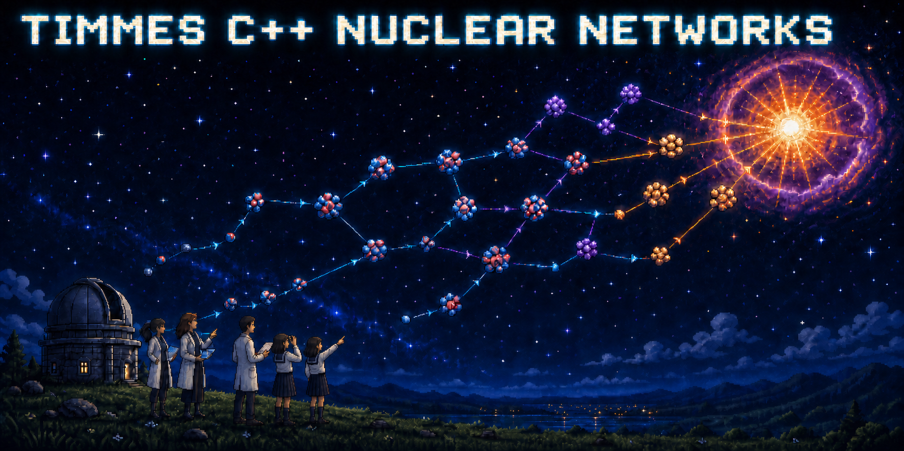

# Timmes C++ 核反応ネットワーク

[English](README.md) | [简体中文](README.zh-CN.md) | [日本語](README.ja.md)

<p align="center">
  
</p>

恒星流体力学向けに作られた Timmes の古典的なハードワイヤード核反応ネットワークを C++20 へ移植したものです。本リポジトリには ARCH で修正・検証済みのネットワークモジュールを収録しており、核種登録の不具合を修正し、実行時の `pynucastro` 依存を取り除いています。

aprox 系列の核物理実装は自己完結しており、外部のネットワーク生成・実行時ライブラリを必要としません。OpenMP およびプロセスローカルな MPI 統合に対応し、CUDA デバイス経路は現在 `aprox13` で検証済みです。4 ネットワークすべては CPU/OpenMP で検証済みです。

> **状態：** 非公開の研究用スナップショットです。現時点では本リポジトリからオープンソースライセンスを付与していません。詳細は [NOTICE.md](NOTICE.md) を参照してください。

## 収録ネットワーク

| ネットワーク | 核種数 | 登録される原子核・粒子 |
| --- | ---: | --- |
| `iso7` | 7 | He-4、C-12、O-16、Ne-20、Mg-24、Si-28、Ni-56 |
| `aprox13` | 13 | He-4 から Ni-56 までの α 鎖 |
| `aprox19` | 19 | H-1、He-3、α 鎖、N-14、Fe-54、中性子、陽子 |
| `aprox21` | 21 | `aprox19` に Cr-56 と Fe-56 を追加 |

解析的反応率、Timmes の遮蔽補正、核質量と結合エネルギー、RHS の組み立て、frozen-screening 組成ヤコビアン、および元の Timmes に一致する解析的な温度行・温度列を実装しています。各 `.inc` ファイルは対応するネットワークヘッダーからインクルードされる C++ ソース断片であり、外部バイナリや実行時生成の依存物ではありません。

## リポジトリ構成

```text
src/physics/network/
├── timmes_common/   共通常数、遮蔽、反応率組み立て、自動微分
├── iso7/            7 核種ネットワーク
├── aprox13/         13 核種 α 鎖ネットワーク
├── aprox19/         19 核種ネットワーク
└── aprox21/         21 核種ネットワーク
```

実装と保守の詳細は [`src/physics/network/TIMMES_NETWORKS_TECHNICAL_NOTE.zh-CN.md`](src/physics/network/TIMMES_NETWORKS_TECHNICAL_NOTE.zh-CN.md) を参照してください。

本リポジトリは **ARCH 用統合モジュール**であり、汎用の単独燃焼ソルバーではありません。核反応率と RHS の式は外部ネットワークライブラリに依存しませんが、`TimmesNetworkSupport.h` は意図的に ARCH の実行時パラメータ、核種マネージャー、および密・疎行列ラッパーを利用します。検証済みの統合を再現するには、このツリーを ARCH の `src/physics/network/` に配置し、使用する `Net*.h/.cpp` を ARCH のネットワークディスパッチと CMake ソース一覧へ接続してください。正確な統合版は[由来と引用](#由来と引用)に記載しています。

## 検証結果

JAIST サーバー上で GCC 13 を使用し、HDF5 を有効にした ARCH の完全な Debug ビルドで検証しました。

| ネットワーク | 核種数 | RHS 相対誤差 | Jacobian 相対誤差 | LHS 相対誤差 |
| --- | ---: | ---: | ---: | ---: |
| `iso7` | 7 | `2.383749e-15` | `2.940236e-15` | `2.856278e-15` |
| `aprox13` | 13 | `3.596869e-14` | `2.850247e-13` | `2.850309e-13` |
| `aprox19` | 19 | `9.991735e-15` | `5.467477e-15` | `5.492012e-15` |
| `aprox21` | 21 | `3.997144e-14` | `1.092265e-14` | `1.091782e-14` |

RHS、完全 Jacobian、および Backward-Euler LHS のすべての直接 Fortran 比較は `1e-12` 未満です。最大値は `aprox13` LHS の `2.850309e-13` です。

NSE bypass を無効にした 3 ステップ燃焼について、OpenMP 1 スレッドと 16 スレッドも比較しました。ステップ 0--3 の各 20 個の HDF5 データセットはすべてビット単位で一致し、新しい Ne20 の生成によりネットワーク・ODE・LU 経路が実行されたことを確認しました。

Helmholtz EOS、`BE_NR`、DenseLU、RK3、HLLC、PPM を用いた CellularDet の 1 ステップ・スモークテストが完了し、二つの大規模ネットワークで正しい核種数が表示されました。

- `aprox19`：`Species Count: 19`
- `aprox21`：`Species Count: 21`

詳細は [docs/VALIDATION.md](docs/VALIDATION.md) を参照してください。

## 現在の対象範囲と制限

- 一致度の結果は、解析的反応率、完全な遮蔽補正、弱反応無効（`weak_on = 0`）の設定を対象としています。
- 弱反応フック `irpen`、`irnep`、`irn56ec` は現在もゼロを返すスタブです。元のルーチンに必要な電子縮退パラメータが現在の ARCH インターフェースから提供されないためです。
- Timmes の `sneut5` ニュートリノ損失は本スナップショットに含まれていません。
- 元の表形式反応率モードは含まず、解析的反応率経路を使用します。
- OpenMP と MPI はプロセスローカルで再入可能な同じネットワーク関数を使用します。MPI の領域分割はホストアプリケーションの責任です。
- CUDA デバイス修飾とクロスアーキテクチャ検証は現在 `aprox13` を対象とします。`iso7`、`aprox19`、`aprox21` の CUDA デバイス検証完了はまだ主張しません。
- 本リポジトリには修正済みネットワークモジュールを保存します。ビルドシステム、OpenMP スケジューリング、ODE、EOS、ディスパッチの変更は下記の ARCH 統合リビジョンにあります。

## 由来と引用

反応率および RHS の式は、F. X. Timmes による `public_iso7.f90`、`public_aprox13.f90`、`public_aprox19.f90`、`public_aprox21.f90` から直接移植しました。公式配布ページは [Cococubed: Nuclear Reaction Networks](https://cococubed.com/code_pages/burn.shtml) です。これらの式は `pynucastro` から生成したものではありません。

C++ のホストインターフェースは [Shiro-Akane/ARCH](https://github.com/Shiro-Akane/ARCH) 向けに開発されました。検証済みの統合ソースは ARCH コミット [`f637597`](https://github.com/Shiro-Akane/ARCH/commit/f63759752c2d0c0d8332cd109febb88a6843b7d9) です。

科学研究で本ネットワーク手法を使用する際は、次の論文を引用してください。

> F. X. Timmes, “Integration of Nuclear Reaction Networks for Stellar Hydrodynamics,” *The Astrophysical Journal Supplement Series* 124(1), 241–263 (1999). [doi:10.1086/313257](https://doi.org/10.1086/313257)

## 関連プロジェクト

[Shiro-Akane/ARCH](https://github.com/Shiro-Akane/ARCH) — 本修正版ネットワーク統合の対象となる恒星流体力学プロジェクトです。
