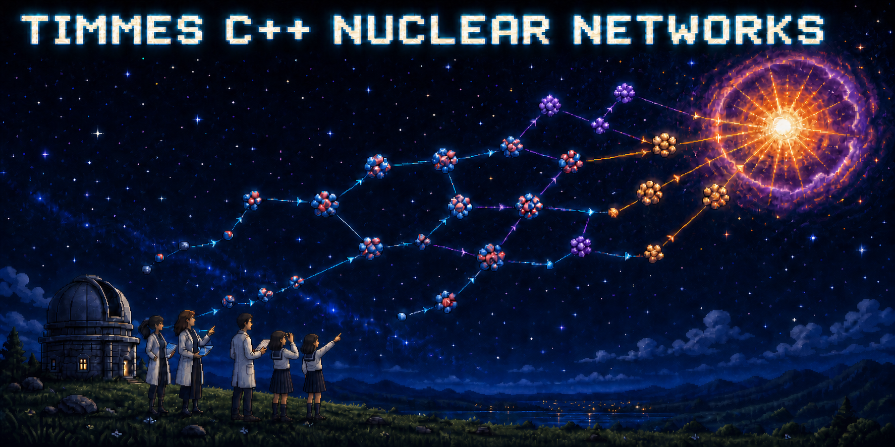

# Timmes C++ Nuclear Networks

[English](README.md) | [简体中文](README.zh-CN.md) | [日本語](README.ja.md)

<p align="center">
  
</p>

Validated C++20 ports of the classic Timmes hardwired nuclear reaction networks for stellar hydrodynamics. This repository contains the repaired network module used by ARCH, with fixed species registration and no runtime dependency on `pynucastro`.

> **Status:** private research snapshot. No open-source license is granted by this repository at this time; see [NOTICE.md](NOTICE.md).

## Included networks

| Network | Species | Registered nuclei/particles |
| --- | ---: | --- |
| `iso7` | 7 | He-4, C-12, O-16, Ne-20, Mg-24, Si-28, Ni-56 |
| `aprox13` | 13 | Alpha chain from He-4 through Ni-56 |
| `aprox19` | 19 | H-1, He-3, the alpha chain, N-14, Fe-54, neutron and proton |
| `aprox21` | 21 | `aprox19` plus Cr-56 and Fe-56 |

The implementation includes analytic reaction-rate expressions, Timmes screening, nuclear masses and binding energies, RHS assembly, and a forward-mode automatic-differentiation Jacobian. Each `.inc` file is C++ included by its matching network header; it is not an external binary or generated runtime dependency.

## Repository layout

```text
src/physics/network/
├── timmes_common/   shared constants, screening, rate assembly and AD support
├── iso7/            7-species network
├── aprox13/         13-species alpha-chain network
├── aprox19/         19-species network
└── aprox21/         21-species network
```

This is an **ARCH integration module**, not a general standalone burn solver. `TimmesNetworkSupport.h` intentionally uses ARCH's runtime parameters, species manager, and dense/sparse matrix wrappers. To reproduce the validated integration, place this tree at `src/physics/network/` in ARCH and wire the selected `Net*.h/.cpp` files into ARCH's network dispatch and CMake source list. The exact integrated revision is linked under [Provenance](#provenance-and-citation).

## Validation

The source snapshot was validated on JAIST with GCC 13 in a full Debug ARCH build with HDF5 enabled.

| Network | Registered species | Maximum relative difference from original Fortran |
| --- | ---: | ---: |
| `iso7` | 7 | `3.342993e-16` |
| `aprox13` | 13 | `5.266553e-13` |
| `aprox19` | 19 | `1.033907e-13` |
| `aprox21` | 21 | `2.516835e-13` |

The overall maximum Fortran-parity difference was `5.266553e-13`, below the requested `1e-12` threshold for the tested analytic-rate configurations. Automatic-differentiation Jacobians were also checked against finite differences; maximum relative disagreements were `1.558187e-6`, `8.517464e-7`, `4.329912e-6`, and `1.928217e-6` for `iso7`, `aprox13`, `aprox19`, and `aprox21`, respectively. These finite-difference comparisons are recorded separately from the direct physics parity result.

CellularDet one-step smoke runs with Helmholtz EOS, `BE_NR`, DenseLU, RK3, HLLC and PPM completed for both larger networks and reported the correct values:

- `aprox19`: `Species Count: 19`
- `aprox21`: `Species Count: 21`

More detail is available in [docs/VALIDATION.md](docs/VALIDATION.md).

## Current scope and limitations

- The parity results cover analytic rates with full screening and weak rates disabled (`weak_on = 0`).
- Weak-rate hooks `irpen`, `irnep`, and `irn56ec` remain zero stubs because the current ARCH interface does not provide the electron degeneracy input required by the original routines.
- Timmes `sneut5` neutrino-loss physics is not included in this snapshot.
- The original tabulated-rate mode is not included; this port uses the analytic-rate path.
- This repository preserves only the repaired network module. Build-system and dispatch changes remain in the linked ARCH integration revision.

## Provenance and citation

The rate and RHS expressions were translated directly from the supplied `public_iso7.f90`, `public_aprox13.f90`, `public_aprox19.f90`, and `public_aprox21.f90` sources by F. X. Timmes. The official source page is [Cococubed: Nuclear Reaction Networks](https://cococubed.com/code_pages/burn.shtml). These equations are not generated from `pynucastro`.

The C++ host interfaces were developed for [Shiro-Akane/ARCH](https://github.com/Shiro-Akane/ARCH). The validated integrated source is ARCH commit [`68f401c`](https://github.com/Shiro-Akane/ARCH/commit/68f401cb0edf2bc0bedb3734d9d4cd569d6c56fb).

When using the network method scientifically, cite:

> F. X. Timmes, “Integration of Nuclear Reaction Networks for Stellar Hydrodynamics,” *The Astrophysical Journal Supplement Series* 124(1), 241–263 (1999). [doi:10.1086/313257](https://doi.org/10.1086/313257)

## Related project

[Shiro-Akane/ARCH](https://github.com/Shiro-Akane/ARCH) — the stellar-hydrodynamics project for which this repaired network integration was developed.
