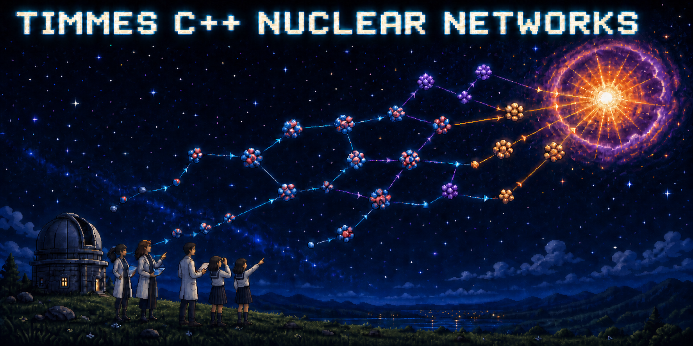

# Timmes C++ 核反应网络

[English](README.md) | [简体中文](README.zh-CN.md) | [日本語](README.ja.md)

<p align="center">
  
</p>

这是经典 Timmes 恒星流体力学硬编码核反应网络的 C++20 移植版本。本仓库保存 ARCH 中已经修复并验证的网络模块，修正了核素注册问题，并且在运行时不依赖 `pynucastro`。

> **状态：** 私有研究快照。本仓库目前不授予开源许可证，详情请见 [NOTICE.md](NOTICE.md)。

## 包含的网络

| 网络 | 核素数 | 注册的原子核/粒子 |
| --- | ---: | --- |
| `iso7` | 7 | He-4、C-12、O-16、Ne-20、Mg-24、Si-28、Ni-56 |
| `aprox13` | 13 | 从 He-4 到 Ni-56 的 α 链 |
| `aprox19` | 19 | H-1、He-3、α 链、N-14、Fe-54、中子和质子 |
| `aprox21` | 21 | 在 `aprox19` 基础上增加 Cr-56 和 Fe-56 |

实现内容包括解析反应率公式、Timmes 屏蔽修正、原子核质量与结合能、RHS 组装，以及使用前向模式自动微分计算的雅可比矩阵。每个 `.inc` 文件都是由对应网络头文件包含的 C++ 源码片段，不是外部二进制文件，也不是运行时生成的依赖。

## 仓库结构

```text
src/physics/network/
├── timmes_common/   共享常数、屏蔽、反应率组装和自动微分支持
├── iso7/            7 核素网络
├── aprox13/         13 核素 α 链网络
├── aprox19/         19 核素网络
└── aprox21/         21 核素网络
```

这是一个 **ARCH 集成模块**，并不是通用的独立燃烧求解器。`TimmesNetworkSupport.h` 有意复用 ARCH 的运行参数、核素管理器以及稠密/稀疏矩阵封装。要复现已验证的集成，请把本源码树放到 ARCH 的 `src/physics/network/`，再把选用的 `Net*.h/.cpp` 接入 ARCH 的网络分发与 CMake 源文件列表。精确的集成版本见[来源与引用](#来源与引用)。

## 验证结果

此源码快照已在 JAIST 服务器上使用 GCC 13、启用 HDF5 的完整 Debug ARCH 构建进行验证。

| 网络 | 实际注册核素数 | 相对原始 Fortran 的最大相对误差 |
| --- | ---: | ---: |
| `iso7` | 7 | `3.342993e-16` |
| `aprox13` | 13 | `5.266553e-13` |
| `aprox19` | 19 | `1.033907e-13` |
| `aprox21` | 21 | `2.516835e-13` |

在测试过的解析反应率配置中，四个网络与 Fortran 的总体最大误差为 `5.266553e-13`，低于要求的 `1e-12`。自动微分雅可比也与有限差分进行过核对；`iso7`、`aprox13`、`aprox19`、`aprox21` 的最大相对差分别为 `1.558187e-6`、`8.517464e-7`、`4.329912e-6` 和 `1.928217e-6`。有限差分核对与直接物理结果一致性测试分别记录，避免把两种误差混为一谈。

使用 Helmholtz EOS、`BE_NR`、DenseLU、RK3、HLLC 和 PPM 的 CellularDet 单步冒烟测试均已完成，两个较大网络报告了正确的核素数：

- `aprox19`：`Species Count: 19`
- `aprox21`：`Species Count: 21`

更多信息见 [docs/VALIDATION.md](docs/VALIDATION.md)。

## 当前范围与限制

- 一致性结果针对解析反应率、完整屏蔽修正以及关闭弱反应（`weak_on = 0`）的配置。
- 弱反应接口 `irpen`、`irnep` 和 `irn56ec` 目前仍为返回零的占位实现，因为现有 ARCH 接口没有提供原始例程所需的电子简并参数。
- 本快照未包含 Timmes `sneut5` 中微子能损物理。
- 本移植使用解析反应率路径，未包含原始的反应率查表模式。
- 本仓库只保存修复后的网络模块；构建系统和网络分发的改动保留在下方链接的 ARCH 集成版本中。

## 来源与引用

反应率和 RHS 表达式直接翻译自 F. X. Timmes 的 `public_iso7.f90`、`public_aprox13.f90`、`public_aprox19.f90` 和 `public_aprox21.f90`。原始代码页面为 [Cococubed：Nuclear Reaction Networks](https://cococubed.com/code_pages/burn.shtml)。这些方程并非由 `pynucastro` 生成。

C++ 宿主接口面向 [Shiro-Akane/ARCH](https://github.com/Shiro-Akane/ARCH) 开发。已经验证的完整集成源码位于 ARCH 提交 [`68f401c`](https://github.com/Shiro-Akane/ARCH/commit/68f401cb0edf2bc0bedb3734d9d4cd569d6c56fb)。

在科研工作中使用该网络方法时，请引用：

> F. X. Timmes, “Integration of Nuclear Reaction Networks for Stellar Hydrodynamics,” *The Astrophysical Journal Supplement Series* 124(1), 241–263 (1999). [doi:10.1086/313257](https://doi.org/10.1086/313257)

## 相关项目

[Shiro-Akane/ARCH](https://github.com/Shiro-Akane/ARCH) — 本修复网络集成所服务的恒星流体力学项目。
